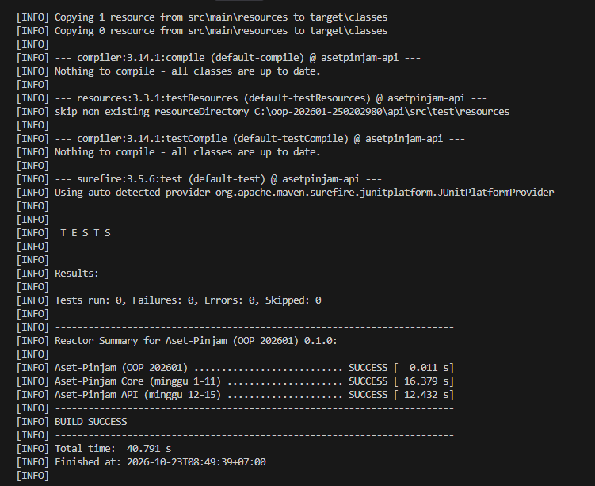
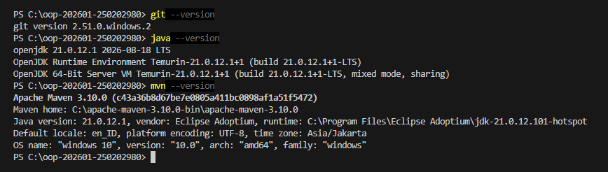

# Catatan Minggu 01 : Paradigma Pemrograman dan Setup

## Yang saya kerjakan

Yang saya kerjakan di minggu 01 yaitu mengisi data identitas mahasiswa, melengkapi template kode yang sudah ada pada file "HelloProsedural.java", "HelloOOP.java", dan "HelloFungsional.java" agar menghasilkan output sapaan yang sesuai dengan ketentuan. Kemudian saya menjalankan uji tes dengan script yang sudah tertera. 

## Keputusan desain

Saya menggunakan format teks sapaan yang sama diketiga kodenya yaitu menggunakan "Hello Aset-Pinjam, saya (Nama) (Nim)" kurang lebihnya begitu, hanya berbeda di cara menulis kodenya, jika prosedural pakai fungsi statis, OOP pakai field private, dan fungsional pakai lambda. Hasil outputnya tetap sama walau cara nulis kodenya itu berbeda. 

## Kendala
Kendala yang saya alami itu ada beberapa antara lainnya yaitu:

- perintah mvn dan skrip pengujian sempat terjadi error karena bermasalah di jalur Path maven dan izin akses powershell.
- Saat pengujian juga sempat terjadi error, gara-gara ada perbedaan 1 huruf kapital pada kata "Aset-Pinjam".

## Penggunaan AI
- Alat yang dipakai: Gemini
- Bagian yang dibantu AI: Kelas _HelloProsedural_ , _HelloFungsional_ , _HelloOOP_ membantu membenarkan kode yang saya lengkapi tetapi masih salah. Membantu menangangi error terminal powershell.
- Prompt utama: 

  1. "kode HelloProsedural, HelloOOP, sama HelloFungsional aku udah diisi tapi tesnya gagal karena beda huruf kapital Aset-Pinjam dan Aset-pinjam, ini yang bener yang mana?"
  2. "gimana cara ngatasin error mvn not recognized di terminal VS Code?"
  3. "kenapa pas nge-running script uji.ps1 di powershell malah terblokir execution policy?"

- Yang saya ubah atau tolak dari saran AI, dan alasannya: Tidak ada
- Satu hal yang saya pahami lebih baik sekarang: Saya jadi lebih memahami perbedaan cara penulisan kode di 3 paradigma. Dan saya juga menyadari betapa pentingnya ketelitian saat menuliskan kode.
